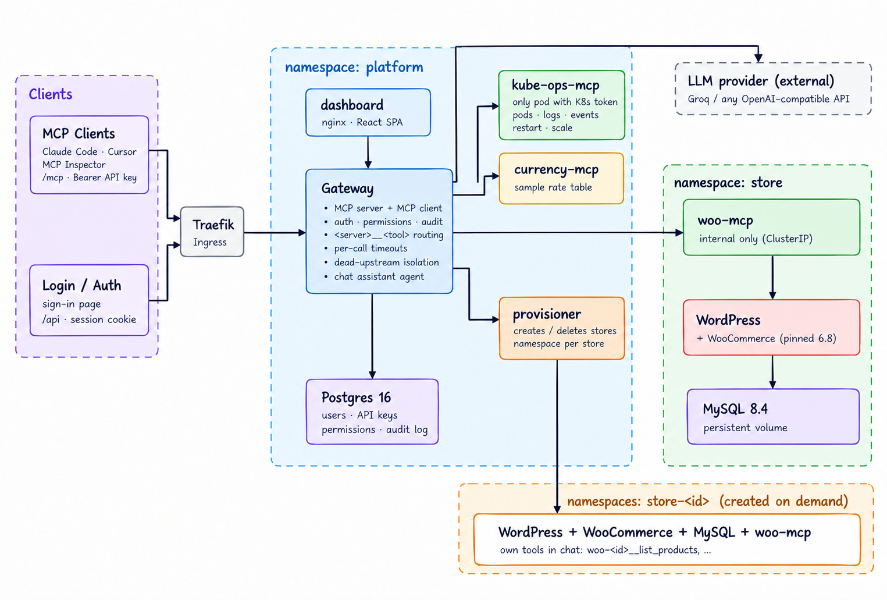

# MCP Portal

**One door to every MCP server your team uses, running on Kubernetes.**

Admins connect MCP servers once. Everyone else gets their tools through a single endpoint and a chat assistant, with their own API key, their own permissions, and an audit trail of every call.

MCP Portal ships with a WooCommerce store, a WooCommerce MCP server, two additional upstreams, a React dashboard, a chat agent that acts as the signed-in user, and a provisioner that spins up isolated stores on demand. The same Helm-based setup runs locally on k3d and on a VPS using k3s.

---

## What you get

| | |
|---|---|
| **One endpoint** | Add `http://<host>/mcp` and your API key to Claude Code, Cursor, or MCP Inspector. Tools from every enabled upstream are available through one endpoint; upstream credentials never reach the client. |
| **Chat assistant** | Ask “What orders came in today?” or “Convert that total to USD.” The assistant calls tools through the gateway **as you**, shows each call, and records it in the audit log under your identity. |
| **Four upstream types** | `woo` (WooCommerce store), `kube-ops` (platform diagnostics), `currency` (currency conversion), and a deliberately malicious test server for the security demo. Additional stores register their own WooCommerce upstreams. |
| **Safe by default** | Hashed and revocable API keys, per-tool permissions, encrypted upstream credentials, quarantine for poisoned tool descriptions and rug pulls, an SSRF guard, and default-deny NetworkPolicies. |
| **Resilient** | Parallel catalog refresh, per-upstream timeouts, circuit breakers, and health monitoring keep a dead or slow upstream from blocking the other servers. The dashboard reports why a server is unreachable. |
| **Multi-store** | Create and delete WooCommerce stores from the dashboard. Each extra store gets its own namespace, database, credentials, storage, quota, and WooCommerce MCP server. |
| **Same chart everywhere** | `values-local.yaml` for k3d and `values-prod.yaml` for a k3s VPS. Helm supports repeatable upgrades and rollbacks. |

## Architecture



Only the Ingress is public. MCP servers use internal Kubernetes Services and are restricted by default-deny NetworkPolicies. The gateway is the control point for authentication, policy checks, routing, timeouts, audit logging, and chat tool execution.

The default store runs in the `store` namespace. Gateway state and platform upstreams live in `platform`. Each additional store is installed in a separate `store-<id>` namespace by the provisioner.

More detail: [`docs/DESIGN.md`](docs/DESIGN.md).

---

## Quick start (local, about 10 minutes)

**Needs:** Docker Desktop with the Linux container engine running, [k3d](https://k3d.io), kubectl, Helm 3.14+, Node.js 22+, and ports 80/443 available.

Run the commands from the repository root. The image build/import commands below are for the `mcp-portal` k3d cluster.

```powershell
# Create the local cluster
k3d cluster create --config deploy/k3d.yaml

# Build the seven project images
make images TAG=dev

# Import the images into the cluster
k3d image import mcp-portal-gateway:dev mcp-portal-dashboard:dev mcp-portal-woo-mcp:dev mcp-portal-kube-ops-mcp:dev mcp-portal-currency-mcp:dev mcp-portal-evil-mcp:dev mcp-portal-provisioner:dev -c mcp-portal

# Install the platform and default WooCommerce store
helm upgrade --install mcp-portal charts/mcp-portal `
  -f charts/mcp-portal/values-local.yaml `
  -f values-secret.yaml `
  --set image.tag=dev `
  --namespace default --wait --wait-for-jobs --timeout 20m

# Create demo admin/member accounts and API keys
node scripts/demo-users.mjs
```

The demo-user script writes generated credentials to `.demo/credentials.txt`. Keep that file private and do not commit it.

Create `values-secret.yaml` in the repository root for your LLM configuration. Add this file to `.gitignore` before using real credentials:

```yaml
platform:
  gateway:
    llm:
      apiKey: "<your-provider-api-key>"
      baseUrl: "<OpenAI-compatible-endpoint>"
      model: "<model-supported-by-your-provider>"
```

Use an OpenAI-compatible endpoint, model, and API key that belong together. Keep `values-secret.yaml` out of Git and pass it on every Helm upgrade; Helm does not automatically retain values supplied only by a previous command-line override.

| Open | |
|---|---|
| [http://mcp-portal.localtest.me](http://mcp-portal.localtest.me) | Dashboard and MCP endpoint |
| [http://shop.localtest.me](http://shop.localtest.me) | WooCommerce storefront |
| [http://shop.localtest.me/wp-admin](http://shop.localtest.me/wp-admin) | WordPress admin |

If `localtest.me` does not resolve in your environment, add this line to your hosts file:

```text
127.0.0.1 mcp-portal.localtest.me shop.localtest.me
```

Full setup, image publishing, and troubleshooting: [`docs/DEPLOY-VPS.md`](docs/DEPLOY-VPS.md).

## Try it

1. **Place an order.** Open the storefront, add a product to the cart, and check out with *Cash on delivery* if enabled. The order will appear in WooCommerce and can be queried through the gateway.
2. **Ask the assistant.** Sign in to the dashboard as an admin and open **Chat**. Try “List the products in my store” or “What orders came in today?” To demonstrate a write tool, ask “Create a product called Demo Mug priced 499,” then verify it in WooCommerce.
3. **Connect an external client as a member.** Use **Connect a client** in the dashboard, or run:

   ```powershell
   claude mcp add --transport http mcp-portal http://mcp-portal.localtest.me/mcp --header "Authorization: Bearer <member-api-key>"
   ```

   List the tools, ask the same orders question, then try a request that uses two upstreams, such as “Get today's orders and convert the total to USD.”
4. **Test permissions.** Revoke the member's API key and confirm the next request is rejected. Disable an upstream and check that its tools disappear from the available tool list.
5. **Test failure isolation.** Remove or scale down one upstream pod and confirm the other upstreams keep working while the dashboard identifies the unavailable server.
6. **Read the audit log.** Check that tool calls and rejected attempts are attributed to the correct user.
7. **Demonstrate tool quarantine.** In **Servers → Add server**, add the deliberately malicious test server. Inspect the scanner's reasons and confirm the flagged tool remains quarantined until an admin approves it.
8. **Create another store.** Use **Stores → Create store**. Once it is ready, verify that its WooCommerce tools are registered and cannot be used by another member who does not own that store.

See [`docs/DEMO.md`](docs/DEMO.md) for the end-to-end demonstration script.

## Connect an external MCP client

MCP Portal exposes a Streamable HTTP endpoint. Use the API key created for the specific user; do not use an upstream WooCommerce or platform credential.

| Setting | Local | Production |
|---|---|---|
| Endpoint | `http://mcp-portal.localtest.me/mcp` | `https://mcp-portal.example.com/mcp` |
| Transport | Streamable HTTP | Streamable HTTP |
| Authentication | `Authorization: Bearer <user-api-key>` | `Authorization: Bearer <user-api-key>` |

For example, Claude Code can be configured with:

```bash
claude mcp add --transport http mcp-portal \
  http://mcp-portal.localtest.me/mcp \
  --header "Authorization: Bearer <member-api-key>"
```

The gateway names tools using `<server>__<tool>` (for example, `woo__list_products`, `kube-ops__list_pods`, or `currency__convert_currency`). Extra stores use their own server identifiers. This prevents collisions when upstreams expose the same tool name.

For large tool catalogues, the gateway also exposes the lazy endpoint at `/mcp/lazy`. It provides meta-tools for searching the available tools, inspecting a tool schema, and invoking a tool without loading the entire catalogue into the model context. Calls through lazy mode still pass through the same authorization and audit path.

**Security:** API keys are secrets. Do not paste them into public issues, screenshots, source code, or chat transcripts. Revoke an exposed key from the dashboard and create a new one.

## Deploy to a VPS

The same Helm chart runs on k3s. The repository's reference deployment uses a Linux VPS; the documented baseline is approximately 2 vCPU and 4 GB RAM for the platform and one store. Multi-store demos need more memory.

1. Prepare a Linux VPS and install k3s.
2. Configure DNS to point your MCP Portal and storefront hostnames at the VPS, or use the documented `sslip.io` HTTP-only demo option.
3. Build and publish versioned container images to a registry the VPS can access.
4. Configure production hostnames, image tags, TLS, bootstrap administrator settings, store base domain, and the LLM provider in a private override file.
5. Deploy the production values and your private override:

```bash
curl -sfL https://get.k3s.io | sh -
helm upgrade --install mcp-portal charts/mcp-portal -f charts/mcp-portal/values-prod.yaml -f my-values.yaml --namespace default --wait --wait-for-jobs --timeout 20m
helm history mcp-portal
helm rollback mcp-portal <revision> --wait
```

For a real deployment, use TLS and secure session cookies, keep credentials out of Git, restrict access to `/wp-admin` and `/wp-login.php`, back up database volumes and encryption Secrets, and verify that NetworkPolicies are enforced by the cluster network plugin. The `sslip.io` HTTP-only mode is for a demo, not for customer data.

Detailed VPS instructions, DNS/TLS setup, image publishing, upgrades, rollbacks, backups, and troubleshooting: [`docs/DEPLOY-VPS.md`](docs/DEPLOY-VPS.md).

---

## What is where

| Path | Contents |
|---|---|
| `apps/gateway` | MCP gateway, authentication, authorization, upstream routing/health, audit log, and chat agent |
| `apps/dashboard` | React dashboard for servers, tools, stores, team, API keys, audit, chat, and client connection details |
| `apps/provisioner` | Creates and deletes isolated WooCommerce stores |
| `mcp-servers/woo-mcp` | WooCommerce products, orders, order status, and sales tools via the WooCommerce REST API |
| `mcp-servers/kube-ops-mcp` | Scoped Kubernetes diagnostics; administrative restart/scale actions are restricted |
| `mcp-servers/currency-mcp` | Currency lookup/conversion tools |
| `mcp-servers/evil-mcp` | Deliberately malicious fixture for tool-description poisoning and rug-pull demonstrations |
| `packages/mcp-kit` | Shared MCP server utilities |
| `charts/mcp-portal` | Platform and default store Helm chart, including local and production values |
| `charts/mcp-store` | Helm chart installed for each additional store |
| `scripts/` | Demo account creation, chart rendering, and isolation checks |
| `docs/` | System design, threat model, deployment guide, demo notes, and feature inventory |

## Documents

| Document | Contents |
|---|---|
| [`docs/DEPLOY-VPS.md`](docs/DEPLOY-VPS.md) | Local and VPS setup, image publishing, upgrade, rollback, backups, observability, and troubleshooting |
| [`docs/DESIGN.md`](docs/DESIGN.md) | Architecture choices, request flow, failure handling, authorization, and design tradeoffs |
| [`docs/THREAT_MODEL.md`](docs/THREAT_MODEL.md) | Shared credentials, client-token boundaries, malicious upstreams, team isolation, Kubernetes boundaries, and known gaps |
| [`docs/MULTI-STORE.md`](docs/MULTI-STORE.md) | Store provisioning, lifecycle, recovery, quotas, and isolation |
| [`docs/DEMO.md`](docs/DEMO.md) | End-to-end demo walkthrough |
| [`docs/STAND-OUTS.md`](docs/STAND-OUTS.md) | Core requirements, bonus features, stand-outs, source locations, and items not implemented |

## System design and tradeoffs

This section follows the decisions documented in [`docs/DESIGN.md`](docs/DESIGN.md).

### Architecture choices

- **One gateway for every caller.** Dashboard tools, external MCP clients, and chat tool calls go through `GatewayService.callTool(principal, name, args)`. This keeps authorization, rate limits, quarantine, timeout handling, and auditing in one path.
- **Stateless Streamable HTTP.** Each request is self-contained, so replicas can serve requests without session affinity and restarts do not lose MCP session state. The tradeoff is that server-initiated notifications and long-lived streams are not used.
- **WooCommerce REST API.** `woo-mcp` uses a scoped REST API key belonging to a low-privilege `shop_manager` user. This preserves WooCommerce business rules and is safer than direct SQL or shell access.
- **Namespaced tool names.** The gateway prefixes tools with the upstream identifier, such as `woo__list_products`, preventing collisions and ensuring a call routes to the intended server.
- **PostgreSQL platform state.** User identities, hashed API keys, permissions, upstream configuration, audit records, and conversations are stored separately from the WooCommerce MySQL data.
- **Separate namespaces and charts.** The platform and default store are installed together as one release across `platform` and `store`; each additional store uses `charts/mcp-store` in a separate `store-<id>` namespace.

### Tool aggregation, routing, and failure handling

The gateway discovers tools from configured upstreams and aggregates them into one caller-specific catalogue. Catalog refresh happens in parallel, with a timeout for each upstream. Before any tool call, the gateway authenticates the caller and evaluates permissions. Only then does it route the namespaced tool to its matching upstream and attach that upstream's server-side credential.

Each upstream has its own health monitor and circuit breaker. A slow server cannot hold up catalog refresh indefinitely, and repeated failures temporarily open the circuit to avoid waiting on every request. During a short outage, last-known tools can remain visible but are marked unreachable; calls to a dead upstream return an error rather than fabricated data. A healthy upstream remains available when a sibling is failing.

The chat agent is another MCP client, not a privileged bypass. It connects in-process as the signed-in user's principal, receives that user's permitted tools, and sends tool calls through the same gateway policy path. Tool calls and rejected attempts are audited under the user's identity.

### Intentional tradeoffs

| Choice | Benefit | Cost or limitation |
|---|---|---|
| PostgreSQL for platform state | Durable records, transactions, and searchable audits | Adds a stateful dependency |
| In-memory rate limits and login throttling | No extra service required | Limits are per replica; Redis or a shared counter would be needed for cluster-wide enforcement |
| Audit log in the same database | Simple to query and associate with application actions | Not tamper-evident; a stronger deployment could export events to an append-only sink |
| Single WordPress replica per store | Simple storage and deployment model | No high availability for the storefront; scaling media needs an appropriate shared/object storage design |
| Helm-based provisioner | Reuses existing charts and makes store creation repeatable | Requires carefully constrained Kubernetes permissions |
| Heuristic tool-poisoning scanner | Flags common malicious descriptions and explains why | Cannot prove a tool is safe; quarantine-on-change and least-privilege permissions remain important |
| API keys for external clients | Simple compatibility with MCP clients | SSO and OAuth are not implemented |

### What changes for production

The core architecture remains the same, but production configuration must replace local assumptions:

- **DNS:** replace `localtest.me` hosts with a domain you control, or use `sslip.io` only for a temporary HTTP demo.
- **Ingress and TLS:** enable HTTPS and certificate management; set secure cookies and restrict administrative WordPress routes.
- **Storage:** select a persistent storage class suitable for the VPS and establish off-host backups for PostgreSQL, MySQL, WordPress files, and gateway encryption material.
- **Secrets:** inject LLM/upstream keys securely; use generated database credentials and back up encryption keys separately from database backups.
- **Images and replicas:** use immutable/versioned image tags from an accessible registry and production replica/resource settings.
- **Network and operations:** verify default-deny NetworkPolicies are enforced by the CNI, keep internal MCP and database services private, and test restore/rollback procedures.

The details and current chart differences are documented in [`docs/DEPLOY-VPS.md`](docs/DEPLOY-VPS.md).

## Threat model

The detailed threat model is in [`docs/THREAT_MODEL.md`](docs/THREAT_MODEL.md). The key boundaries are summarized below.

### Shared upstream credentials: what a member can do with a credential they never see

The gateway stores one credential per upstream, encrypted at rest, and never returns it through the dashboard API. A member can cause the gateway to use that credential only through tools and operations allowed by the member's permissions. For example, a read-only member can list orders but cannot update an order unless policy explicitly allows that tool.

This is not a substitute for least privilege. A permitted write tool can still make real changes to shared store data. Use a low-privilege WooCommerce account, restrict write tools, and review permissions carefully. If an attacker obtains both the credential store and its encryption key, the encrypted credentials can be recovered.

### Why client tokens are not passed through to upstream servers

A user's API key authenticates the user to MCP Portal only. It is never forwarded to WooCommerce or other upstreams, and it is not used as an upstream credential. After authenticating the user, the gateway checks permissions and adds the server-specific upstream credential itself. This prevents one upstream from learning or replaying a caller's gateway key and keeps trust boundaries separate. Attribution remains in the gateway audit log.

### Untrusted upstreams: tool descriptions written to manipulate the model

A malicious upstream can place instructions inside tool descriptions or results, such as asking the model to hide an action or exfiltrate customer data. The `evil-mcp` fixture demonstrates this. A heuristic scanner can quarantine suspicious descriptions, and approved tool definitions are pinned by hash so a later “rug pull” change triggers quarantine again. Untrusted server annotations are not used to grant members additional trust.

These defences reduce exposure but do not prove arbitrary upstream code or tool output is safe. Tool outputs are treated as untrusted data, results are size-capped, and calls are constrained to the signed-in user's permissions. A malicious server's own results can still be false or manipulative.

### What one team member can do to another

Members should only see their own keys and audit rows, and store tools are private to the store owner and administrators. A broad member permission does not override store ownership. Key authentication is uncached, so revocation and permission changes apply on the next request. Chat conversations are per-user.

Members with shared write access may still change shared team resources, such as creating products or updating orders, when those tools are permitted. Audit records help trace actions, but the current audit store is not tamper-evident. Protect administrator accounts and review permission changes.

### Kubernetes boundary and known gaps

Default-deny NetworkPolicies isolate upstreams, databases, and store namespaces where the cluster CNI enforces them. The `kube-ops-mcp` service account is scoped and cannot read Secrets; restart/scale tools are admin-only. The provisioner has broader privileges than ordinary workloads, so its Kubernetes permissions and admission restrictions deserve particular scrutiny.

Known gaps described in `docs/THREAT_MODEL.md` include shared upstream credentials, heuristic scanning, no confirmation step for chat write actions, per-replica rate limits, a non-tamper-evident audit log, publicly routed WordPress admin paths unless restricted, LLM-provider visibility into prompts/results, and namespace-based isolation rather than separate machines.

## Verify the claims

Run the test and deployment checks from the repository root:

```powershell
npm test
node scripts/render-charts.mjs
bash scripts/verify-isolation.sh
bash scripts/verify-stores.sh
```

`npm test` needs PostgreSQL configured and running for integration tests. `render-charts.mjs` checks rendered chart configuration. The two isolation scripts should be run against a live cluster; `verify-stores.sh` requires at least two extra stores to have been created. These checks exercise specific properties; they are not a complete security audit.

## Bonus and stand-out items

The detailed list and source paths are maintained in [`docs/STAND-OUTS.md`](docs/STAND-OUTS.md). Stand-outs include:

- **Multi-store provisioning:** `apps/provisioner/`, `charts/mcp-store/`, and `docs/MULTI-STORE.md`.
- **Tool-level allow/deny rules:** `apps/gateway/src/policy/engine.ts`.
- **Poisoned tool quarantine and rug-pull detection:** `mcp-servers/evil-mcp/` and `apps/gateway/src/upstreams/`.
- **Kubernetes self-diagnostics with admin-only restart/scale:** `mcp-servers/kube-ops-mcp/`.
- **Lazy search-then-call mode:** `/mcp/lazy` in `apps/gateway/src/mcp/server.ts`.
- **Metrics and health status:** `apps/gateway/src/metrics.ts` and `upstreams/health.ts`.
- **Chart and isolation verification:** `scripts/render-charts.mjs`, `scripts/verify-isolation.sh`, and `scripts/verify-stores.sh`.
- **VPS deployment, upgrade, and rollback instructions:** `docs/DEPLOY-VPS.md`.

Not implemented, as noted in `docs/STAND-OUTS.md`: SSO/OAuth for MCP clients, per-user upstream credentials, and a dedicated Kubernetes operator/CRD for store provisioning.
