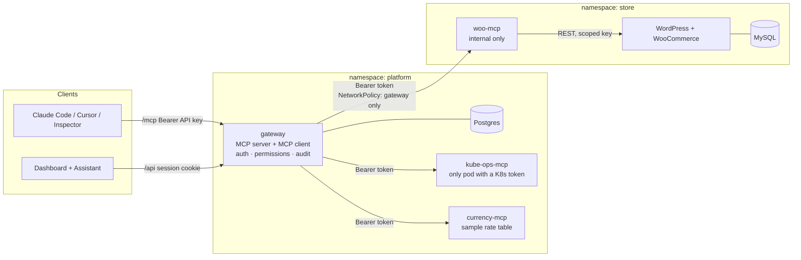

# mcp-portal

A WooCommerce store on Kubernetes, a self-written **WooCommerce MCP server**, and a **team MCP gateway** that puts every tool behind one authenticated, audited endpoint, with a dashboard and a chat assistant that acts as the signed-in user.



| | |
|---|---|
| **Store** | WordPress + WooCommerce (pinned), MySQL 8.4, provisioned by an idempotent Helm hook Job: demo products, a low-privilege `shop_manager` service user, a generated REST key |
| **woo-mcp** | List products, create product, list orders, get order, update order status, plus sales summary and get product. Streamable HTTP, stateless, bearer-token protected, `ClusterIP` only |
| **Gateway** | Aggregates ≥3 upstreams (woo, kube-ops, currency; evil is an optional threat-model fixture) under `<server>__<tool>` names, per-call timeouts, dead-upstream isolation, credentials server-side only |
| **Dashboard** | Servers (Connected / Unreachable / Disabled, tools, add / edit / disable / remove), invites, API keys, permissions, audit log, chat with visible tool calls |
| **Chart** | One Helm chart, `values-local.yaml` and `values-prod.yaml`; probes, requests and limits, Secrets, PVCs, Ingress, default-deny NetworkPolicies |

## Run it locally (about 10 minutes the first time)

Prerequisites: Docker, [k3d](https://k3d.io), kubectl, Helm 3.14+, Node 22 (only for `make demo`). Port 80 and 443 free.

```bash
make up      # k3d cluster + build 6 images + helm install; waits for the WooCommerce setup Job
make demo    # creates an admin and a member, mints API keys, writes .demo/credentials.txt
```

`*.localtest.me` resolves to `127.0.0.1` through public DNS, so no `/etc/hosts` edits are needed. If your DNS blocks it, add
`127.0.0.1 mcp-portal.localtest.me shop.localtest.me` to your hosts file.

| URL | What |
|---|---|
| http://mcp-portal.localtest.me | Dashboard (sign in with the credentials from `make demo`) |
| http://shop.localtest.me | The storefront. Place an order here |
| http://shop.localtest.me/wp-admin | WordPress admin (password: see `helm` output or `.demo/credentials.txt`) |

**Why k3d rather than kind?** k3d runs k3s, so Traefik and the NetworkPolicy engine are the same as on the VPS. With kind the default CNI may not enforce NetworkPolicies. kind and minikube still work: add `-f charts/mcp-portal/values-nginx.yaml` and install ingress-nginx (`make deploy HELM_SET="-f charts/mcp-portal/values-nginx.yaml"`).


### Enable the chat assistant

The assistant works with any OpenAI-compatible provider. Groq's free tier is the default; OpenAI works too:

```bash
# Groq (default base URL and model; check your account has access to the model)
make deploy HELM_SET="--set platform.gateway.llm.apiKey=<your key>"

# OpenAI. Reasoning models only allow tool calls on Chat Completions with reasoning turned off.
make deploy HELM_SET="--set platform.gateway.llm.baseUrl=https://api.openai.com/v1 --set platform.gateway.llm.model=<model> --set platform.gateway.llm.reasoningEffort=none --set platform.gateway.llm.apiKey=<your key>"
```

Rate limits (common on free tiers) are retried up to three times, honouring `Retry-After`, before the chat reports an error.

(Re-running `make deploy` later without the flag would clear the key; keep it in a values file you pass with `-f` if you redeploy often.)

Without a key everything else works and the dashboard says so on the Assistant page.

## The demo, step by step (the "definition of done")

1. **Place an order.** Open http://shop.localtest.me, add *Filter coffee powder* to the cart, check out with *Cash on delivery*.
2. **Admin, through the chat.** Sign in as the admin → *Assistant* → "What orders came in today?" The tool call (`woo/list_orders`) is shown with arguments and result. Then "Mark order #N as completed" and confirm in WooCommerce.
3. **Member, through an MCP client.** Add the member's key to Claude Code (command in `.demo/credentials.txt`), list tools, ask for today's orders. Try to change an order status: the tool isn't even listed.
4. **Two roles, visibly different.** As admin, *Servers → woo → Tools*: set *Members → Always allow* on `update_order_status`. The member's next call succeeds, with no restart and no new key.
5. **Revocation is immediate.** As the member, *API keys → Revoke*. The very next request from that client returns 401, and the attempt appears in the audit log under the member's name.
6. **The platform debugs itself.** Break a server (`kubectl -n platform scale deploy/currency-mcp --replicas=0`). As admin ask the chat: *"Why is the currency server unreachable, and fix it."* It checks pod health, deployment status and events through `kube-ops`, scales the deployment back up and says what it did. As the member, the same request is refused: the restart/scale tools are not even listed. The change shows in the audit log under the admin's name. See [`docs/DEMO.md`](docs/DEMO.md) for the crash-loop variant (logs are treated as untrusted data).
7. **Isolation.** While currency is down, the dashboard shows it *Unreachable* with the reason; woo and the others keep answering at normal speed.
8. **Supply-chain defence.** *Servers → Add server*: `http://evil-mcp.platform.svc.cluster.local:8080/mcp` with the token from `make evil-token`. One tool is quarantined with the exact reasons shown; nobody can call it until an admin approves that exact version.
9. **Prove the claims.** `make verify` runs about 30 checks against the live cluster (other namespaces cannot reach woo-mcp, WordPress or the databases; kube-ops-mcp's ServiceAccount cannot read Secrets or touch the gateway; credentials are absent from API output; and so on).

A shot-by-shot script for the demo video is in [`docs/DEMO.md`](docs/DEMO.md).

## Connect your own MCP client

Dashboard → *Connect a client* shows copy-paste snippets with your URL. Claude Code:

```bash
claude mcp add --transport http mcp-portal http://mcp-portal.localtest.me/mcp \
  --header "Authorization: Bearer <your-api-key>"
```

`/mcp/lazy` exposes three meta tools (search, describe, call) instead of every tool. Use it when the tool list would crowd the model's context. The built-in assistant switches automatically above 40 tools.

## Create your own stores (bonus)

Dashboard → **Stores** → *Create store*. A few minutes later you have a separate WordPress + WooCommerce + MySQL in its own namespace, at `<id>.stores.localtest.me`, with its own tools (`woo-<id>__list_products`, …) in the chat. Delete it and everything goes, volumes included. Details, limits and recovery behaviour: [`docs/MULTI-STORE.md`](docs/MULTI-STORE.md); `make verify-stores` proves the isolation.

## Deploy to a VPS

Same chart, `values-prod.yaml`, k3s: see [`docs/DEPLOY-VPS.md`](docs/DEPLOY-VPS.md) (including the exact local-vs-prod diff, upgrades and rollback).

## Documents

| | |
|---|---|
| [`docs/DESIGN.md`](docs/DESIGN.md) | System design and the tradeoffs behind it |
| [`docs/THREAT_MODEL.md`](docs/THREAT_MODEL.md) | What can go wrong, what stops it, what's left |
| [`docs/MULTI-STORE.md`](docs/MULTI-STORE.md) | Bonus: users create and delete isolated stores from the dashboard |
| [`docs/DEPLOY-VPS.md`](docs/DEPLOY-VPS.md) | k3s on a VPS, TLS, upgrades, rollback, backups |
| [`docs/DEMO.md`](docs/DEMO.md) | Demo video script |
| [`docs/STAND-OUTS.md`](docs/STAND-OUTS.md) | The bonus and stand-out items and where to find each |

## Develop without Kubernetes

```bash
pnpm install
# a Postgres for the integration tests (any 14+ works)
export TEST_DATABASE_URL=postgres://postgres@127.0.0.1:5432/postgres
pnpm test                       # ~190 tests across 7 packages
pnpm run build                  # TypeScript + dashboard

# the whole stack on loopback: mock WooCommerce, kube-ops (in-memory cluster with a crash-looping currency-mcp), currency, evil + gateway
createdb mcp-portal_dev
DATABASE_URL=postgres://postgres@127.0.0.1:5432/mcp-portal_dev npx tsx scripts/dev-stack.mts
pnpm --filter @mcp-portal/dashboard dev       # http://localhost:5173, sign in admin@example.com / admin-password-123
```

The integration tests run the real gateway against a real Postgres and real MCP servers over loopback HTTP (no mocks of the thing being tested). The WooCommerce REST API is the one exception: a mock server that also enforces WooCommerce's "Basic auth needs HTTPS" rule.

## Repository layout

```
apps/gateway        Fastify + MCP SDK: registry, routing, auth, permissions, audit, chat agent
apps/dashboard      React + Vite + Tailwind
apps/provisioner    creates/deletes isolated stores (one namespace + Helm release each)
mcp-servers/        woo-mcp (the assignment's server), kube-ops-mcp, currency-mcp, evil-mcp (fixture)
packages/mcp-kit    shared stateless Streamable HTTP harness for the MCP servers
charts/mcp-portal    the Helm chart (store + platform namespaces)
charts/mcp-store     one WooCommerce store (the provisioner installs one release per store)
docker/             Dockerfiles (non-root, multi-stage), nginx config
scripts/            demo users, isolation checks, chart renderer and linter, local dev stack
```

## What has and hasn't been verified

Verified by running it: all 157 automated tests (real Postgres, real upstreams over loopback); the gateway compiled output booting against Postgres; the dashboard exercised in a real browser (light, dark, mobile); the Helm chart rendered for every profile.

Verified live on a k3d cluster (Docker Desktop, Windows): all six images built; `helm install` with the WooCommerce setup Job; storefront order placed; the store's MCP tools (list products and orders, get an order, sales summary, update an order status, create a product) called through the gateway as admin and as a member; a member's write refused by default and allowed by a rule with no restart; instant key revocation; dead-upstream isolation (a killed server reports Unreachable in 0.04 s while others keep working, and recovers on its own); the poisoned-description server quarantined; NetworkPolicy blocking a stray pod from woo-mcp; the chat assistant calling tools as the signed-in user; both databases killed and the data intact afterwards.

Running it for real found six bugs the automated tests could not (the setup Job lacked the database env vars; secret prefixes stacked on re-install and overflowed a column; WooCommerce ignores API keys on the `?rest_route=` URL form, so woo-mcp now uses `/wp-json/`; the audit page read a field the API does not send; the gateway crash-looped while Postgres pulled its image; the chat had no rate-limit retry). Each is fixed and, where possible, covered by a regression test. Details in `docs/DESIGN.md`.
